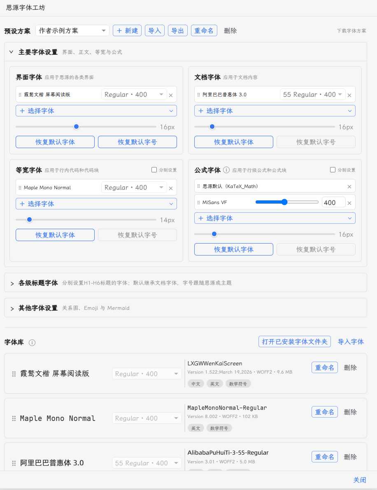

# SiYuan Font Studio

[简体中文](https://github.com/MDfox-ChaosZone/siyuan-font-studio/blob/main/README.md)

Font playground:

- Easily customize a wide range of font elements in SiYuan!
- Freely combine fonts and switch between your font presets!

## Features

Customize the fonts and sizes of the following elements:

| Element | Font | Size | Scope |
| --- | :---: | :---: | --- |
| Interface | ✅ | ✅ | Menus, settings, the document tree, tab bars, sidebars, and other SiYuan UI elements |
| Editor | ✅ | ✅ | Body text, headings, lists, blockquotes, tables, and other document content in the editor |
| Headings | ✅ | ✅ | Independent H1–H6 settings; unset fonts follow the editor font and unset sizes follow SiYuan or the theme |
| Code | ✅ | ✅ | Inline code and code blocks; each can be configured separately |
| Formulas | ✅ | ✅ | Inline formulas and formula blocks; each can be configured separately |
| Graphs | ✅ | ❌ | Document graphs and the global graph |
| Mind maps | ✅ | ✅ | Independent node fonts, weights and sizes under Other font settings |
| Mermaid | ✅ | Partial | Some Mermaid elements use independent fixed font sizes that cannot be overridden consistently |
| Emoji | ✅ | ❌ | Emoji displayed in the document tree, the editor, and similar locations |

- The editor also offers a bold weight and “No faux bold/italic”. These options only change how text is displayed; document content is never modified.
- After you import the Bold, Italic and similar files of the same font, bold and italic text uses those real faces instead of browser-simulated ones.
- Save your settings as presets and switch between them easily. Import and export presets to use them across devices.
- Select multiple fonts to provide fallbacks for missing characters.
- Fonts load on demand: startup loads only fonts used by the current preset; other fonts load when previewed or selected.

### Font size settings

- The editor font's size is SiYuan's editor font size: changes in the plugin are saved to SiYuan's settings, and after you change the editor font size with SiYuan's shortcuts, the current preset picks up the new size the next time the plugin window opens.
- Monospace text and formulas using default sizes scale with the editor font size at the default ratios defined by SiYuan or the theme. Manually set sizes stay fixed; click “Reset size” to follow the editor font size again.
- With “Set separately” enabled, inline code and code blocks, as well as inline formulas and formula blocks, use independent sizes without affecting each other.
- Default sizes display their computed values and may include decimals; manual adjustments still use whole pixels. Hover over the information icon next to “Editor font” for an explanation of how sizes follow the editor font size.

## Additional notes

- For personal use, WOFF2 is recommended for its smaller file size and reduced memory usage. TTF/OTF fonts can be converted online with [CloudConvert](https://cloudconvert.com/ttf-to-woff2) or with my [FontConvert](https://github.com/MDfox-ChaosZone/Font-Converter) project.
  - When distributing fonts, keeping their original format is recommended to respect any restrictions in the font license.

## Changelog

- **v1.3.0**:
  - Added editor options for bold weight and no faux bold/italic.
  - Settings wording now matches SiYuan, for example “Document font” is now “Editor font”.
  - Bold and italic text uses the real faces of the same font when those files are imported.
  - The editor font's size now sets SiYuan's editor font size, fixing conflicts with SiYuan's font-size shortcuts and broken code-block line heights when line numbers are shown.
  - Adapted to SiYuan's newer global fonts, emoji corrections and custom fonts (Docker and mobile); the plugin refreshes when SiYuan's own font settings change.
  - Fixed a security issue where preset import messages could inject HTML, fixed the emoji font overriding SiYuan's editor font, and applied synced settings without reloading the plugin.
  - Removed community preset submission and downloads; only the author's example preset remains.
- **v1.2.0**: Improved font loading: startup loads only fonts used by the current preset, and previews load as you scroll. Font metadata is cached, and Emoji faces load only when used.
- **v1.1.2**:
  - Monospace default sizes now display their computed values. Default monospace and formula size values update immediately when the document font size changes.
  - Fixed a custom inline formula size affecting formula blocks using their default size when “Set separately” was enabled.
  - Fixed mismatches between slider values and displayed values when default sizes fell outside the manual adjustment range. Added a font size tooltip next to “Document font”.
- **v1.1.1**: Fixed spacing between SiYuan's automatic heading numbers and text failing to update immediately when changing document or heading fonts and sizes through the plugin.
- **v1.1.0**: Added mind map font settings.
- **v1.0.0**:
  - Fixed the mismatch between the formula size slider and the actual size after resetting to defaults. Inline formulas and formula blocks display their computed sizes separately; defaults may include decimals, while manual adjustments still use whole pixels.
  - Fixed hard-to-read settings tooltips in themes such as neo by using matching theme background and text colors.
- **v0.1.9**: Added independent H1–H6 fonts, weights, and sizes with default resets and preset import/export; display computed default sizes while preserving older presets; refreshed the plugin preview and documentation.
- **v0.1.8**: Added community preset submission, review, and live downloads; added split uploads for large presets and author-initiated withdrawal; improved the download dialog and saving split packages.
- **v0.1.7**: Improved variable-font support; fixed font weights not applying to formula fallback fonts and prevented those fallbacks from overriding KaTeX digits and operators; fixed failures when downloading the example preset.
- **v0.1.6**: Added font weight display and selection, with compatibility for SiYuan 3.8.2.
- **v0.1.5**: Added on-demand download and automatic import for the example font preset, and refined the preset toolbar layout.
- **v0.1.4 and earlier**: Completed the plugin's core functionality.

## Support and sponsorship

If this plugin is useful to you, please give it a **free Star on GitHub**. It means a lot to me—pretty please!

Any sponsorship is also greatly appreciated!

### WeChat Pay and Alipay

| WeChat Pay | Alipay |
| :---: | :---: |
|  |  |

### USDT

- Plasma: `0x742fa2ac27c5d3ff0c337b93ad688d39a77da4c8`
- Aptos: `0xb3ba1611884cc1c2d2d970d081f6c24089d363817a772bddab52a0a278c6ffef`

| Plasma | Aptos |
| :---: | :---: |
|  |  |
